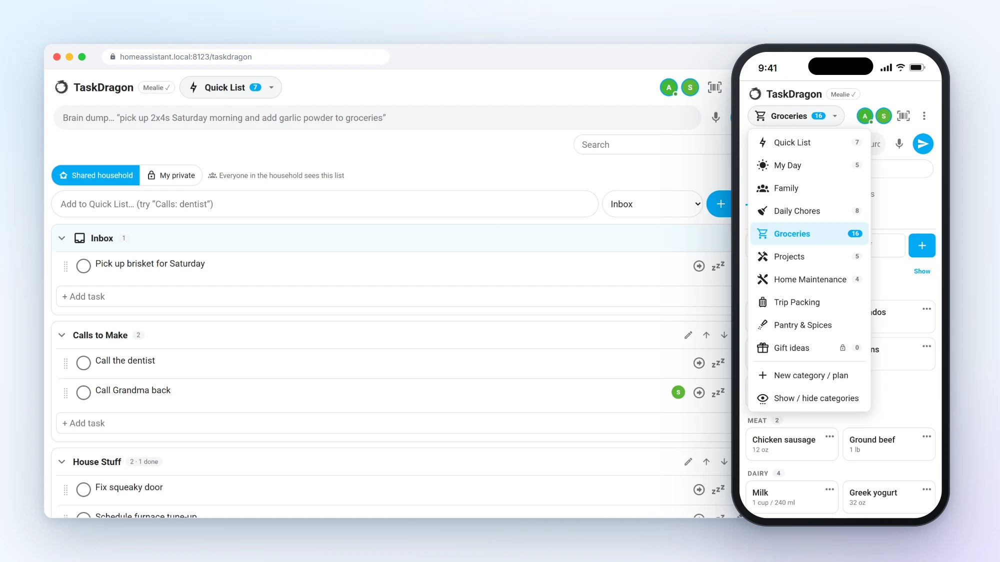
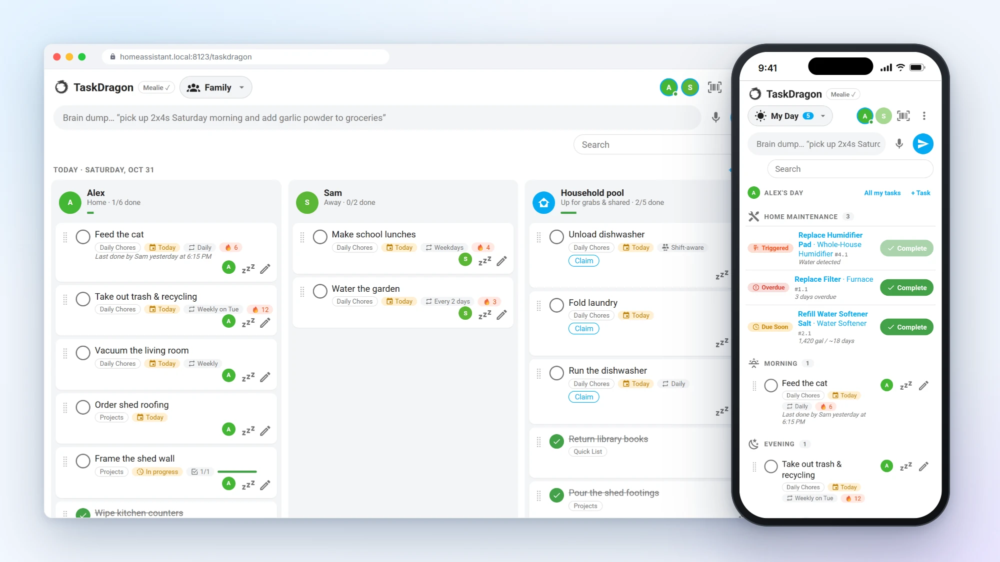
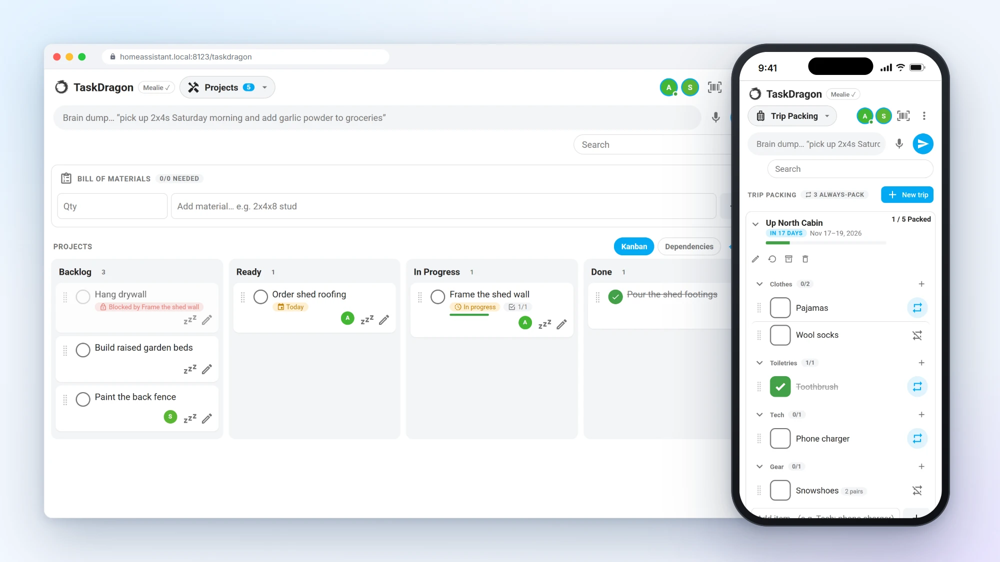
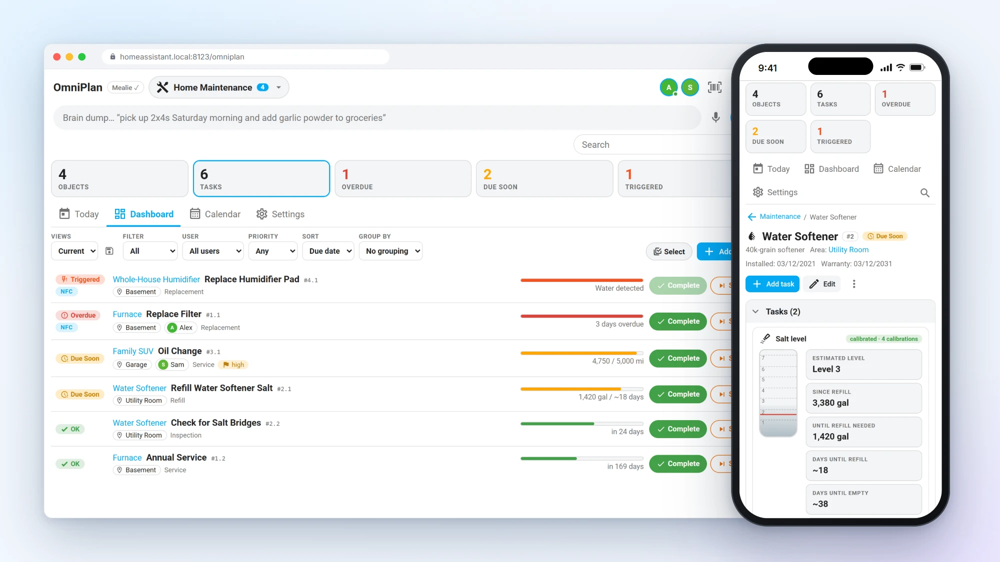
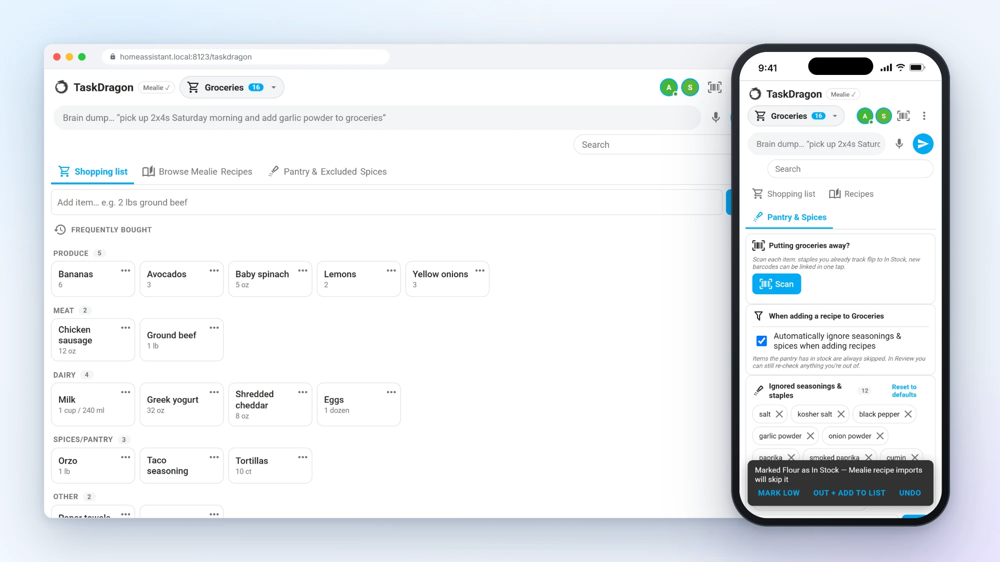
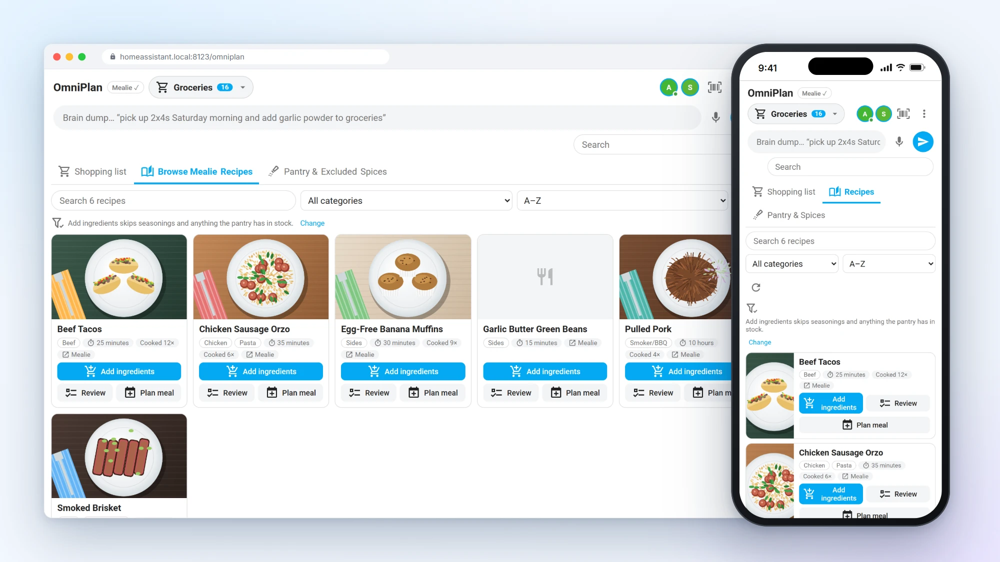
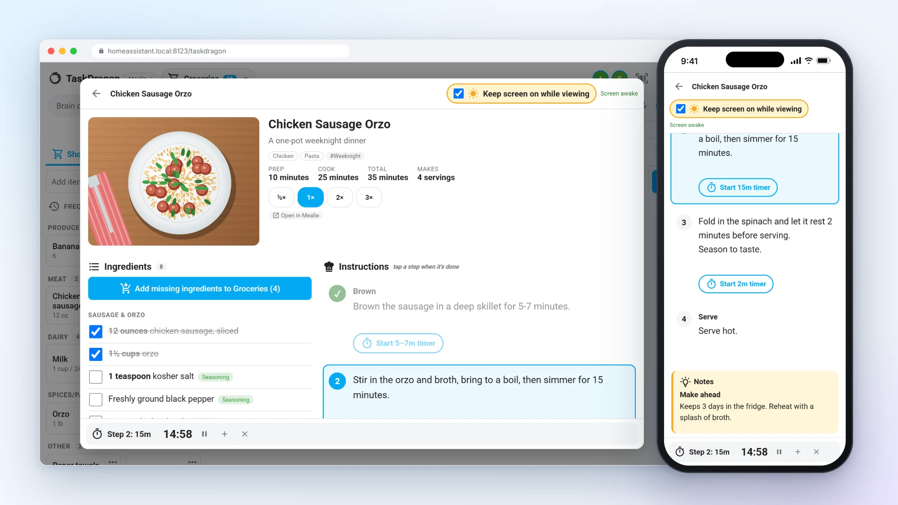
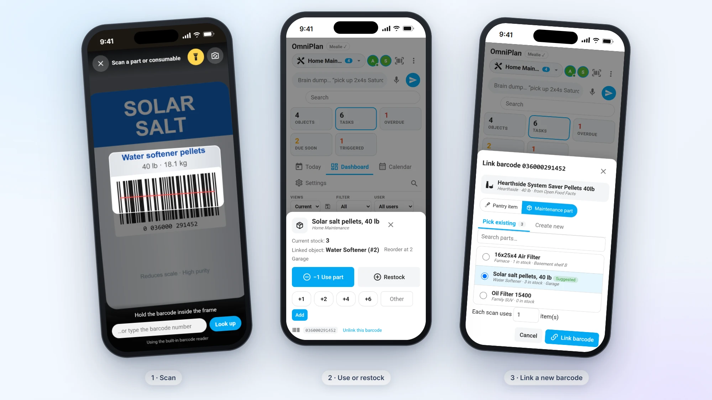
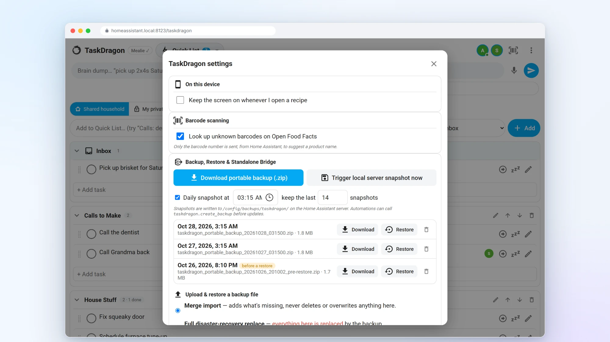

# TaskDragon user guide

Everything TaskDragon does, screen by screen. New here? Start with the [README](../README.md) for installation and a ten-minute setup.

- [Everyday use: the card](#everyday-use-the-card)
- [Recurrence](#recurrence)
- [Home maintenance & assets](#home-maintenance--assets)
- [Groceries, Mealie & the cooking view](#groceries-mealie--the-cooking-view)
- [Wishlist, gifts & price tracker](#wishlist-gifts--price-tracker)
- [Barcode scanning](#barcode-scanning)
- [Backup, restore & standalone bridge](#backup-restore--standalone-bridge)
- [Services, events and security](REFERENCE.md)

## Everyday use: the card

The card's options (view mode, single plan, title…) are listed in the [README](../README.md#card-configuration). The sidebar panel (**TaskDragon**) is the same card, full page.

Everyday tips:
- **Quick List**: type in the top bar and press Enter. Start with a section name to file it there ("Calls: dentist" lands in "Calls to Make"), or use the section picker or the "+ Add task" field inside a section. Section headers collapse (remembered per user, on every device), and the pencil, arrow and trash buttons rename, reorder and delete a section; deleting one moves its tasks to the inbox, with undo.
- **Promote**: the ➜ button on a quick-list item moves it into any plan (shopping items get an aisle, packing items go to the next trip), or **Repeat it…** opens the editor with a weekly schedule pre-filled so it becomes a recurring chore.
- **Categories**: the dropdown in the header (it shows the current category and how many items are open) lists every category with its count. At the bottom, **New category / plan** creates one and **Show / hide categories** hides, shows and reorders them for you only, and lists archived categories so you can restore them.
- **Trips**: "New trip" asks for a name and dates and pre-fills every repeatable item. Tap the big box to pack (it's crossed out instantly), tap ↻ to switch an item between *repeatable* and *one-off* (that applies to the item on every trip), and type "Tech: headlamp" to add into a group. Trips become active on their start date; archive them when you're home.
- Tap a task to expand its notes and checklist. Tap the pencil icon for the full editor (recurrence, assignees, dependencies and history).
- **Groceries**: the **Shopping list | Browse Mealie Recipes | Pantry & Excluded Spices** bar at the top switches between the list, the recipe browser and the import settings (described under Mealie below). Tapping **Mealie ✓** in the header jumps straight to the recipes.
- **Maintenance**: the blue object name opens the object (tasks, documents, parts, full history); the bold task name opens the task (KPIs, timeline, triggers, recommendation, activity). ✔ **Complete** on a row logs it right away with undo; the task page's Complete asks for cost, duration, parts, feedback and a photo.
- Drag the ⋮ handle to reorder, or to move between Morning/Afternoon/Evening, Kanban columns, aisles, quick-list sections, trips and packing groups, or between people in the family view (dropping on a person's column reassigns the task).
- Every completion and delete shows a 5-second **Undo**.
- The ⋮ menu has bulk edit, category settings (sharing, and for administrators routing roles and which Mealie list a shopping plan syncs with), new categories and **Settings & backups** (keep-awake default for this device, the Open Food Facts switch, and backup / restore).
- The **barcode** button in the header scans any barcode and sends you to the pantry item or part it belongs to (see Barcode scanning below).
- The mic uses the browser's speech recognition where it's available (Chrome and Android). On iOS, use the keyboard's dictation button or the [voice automation](REFERENCE.md#voice-brain-dump-through-assist).

## Recurrence

- **Calendar** (`FREQ=DAILY`, `FREQ=WEEKLY;BYDAY=TU,FR`, `FREQ=MONTHLY;BYMONTHDAY=1`, any RRULE): the next due date is the next occurrence after both today and the current due date, so a late completion never schedules the next one in the past.
- **Rolling**: N days after the day you actually finished it.

Completed recurring tasks stay checked until the rollover hour, then re-open, and their checklists reset with them. Streaks count consecutive on-time completions. Maintenance tasks have their own scheduling, described next.

## Home maintenance & assets

A maintenance plan opens on a five-number banner (**Objects · Tasks · Overdue · Due soon · Triggered**; tap one to filter), with **Today**, **Dashboard**, **Calendar** and **Settings** views and a 🔍 search across objects, tasks, parts, notes and documents.

**Objects** are the things you maintain: a furnace, the water softener, a car. Each one has a model, a Home Assistant **area**, an install date, a **warranty expiry** (with a reminder), Markdown notes, and optionally a parent ("Humidifier" inside "Furnace"). Objects are numbered `#1`, `#2`…, their tasks `#2.1`, `#2.2`…, and each logged event `#2.1-4`. Pick a **zone** on an object to hold its notifications until someone from the household is in that zone, so the furnace filter reminder arrives when you get home.

**Tasks** have a category (Replacement, Service, Cleaning, Inspection, Calibration, Refill) and a status: **OK**, **Due soon** (inside the warning window), **Overdue**, or **Triggered** (a sensor condition is met).
- **Rolling** intervals count from the day it was actually done. **Planned** intervals stay on an anchor date, so a late filter change doesn't shift the next one. Either can be in days, weeks, months or years.
- An optional **time of day** decides when a task due today turns Overdue. **Active months** limit a task to a season (a humidifier pad from October to April); due dates that fall outside are moved to the next active month.
- **Sensor triggers**, combined with AND or OR, and alongside a schedule or instead of one:
  - **Threshold**: above or below a value for N minutes (filter ΔP, battery %).
  - **Counter**: a total that increases by N (gallons through a filter, kWh, odometer miles, 3D-printer hours).
  - **Runtime**: hours spent in a state, including attributes such as a thermostat's `hvac_action: heating`.
  - **Cycles**: N state changes with a debounce, for things like dishwasher runs. Restarts don't count as changes.
  - **Problem sensor**: a leak or problem sensor turning on. It can mark the task done automatically when the sensor recovers.
- **When completed**, a task can take parts out of stock, rotate the assignee to the next person, and (if an administrator set it up) run a service such as `button.press` on a filter-reset button.
- **Adaptive interval**: after each completion, answer *Too early*, *Just right* or *Too late*. TaskDragon blends an exponentially weighted average of your real intervals, a Weibull fit and 12-month seasonal factors into a suggestion. **Apply recommended interval** adopts it, and **Re-analyze** recomputes it.
- **Complete** logs the date, who did it, duration, labor cost, the parts used, notes, the feedback and a photo. **Skip** records *Skipped* before the due date, or *Missed* once the task is overdue or triggered.

**NFC and QR**: in a task's ⋮ menu, **Bind NFC tag** listens for 60 seconds; scan a Home Assistant tag at the appliance and it's linked. From then on, scanning that tag completes the task ("Completed via NFC tag"). Tick **Only complete by scanning the tag** to require being there. **QR code** (on any object or task) prints or downloads a label that opens the item in the TaskDragon panel, or, for tasks, asks *Mark as done?* right away. QR links open the TaskDragon sidebar panel, so keep it enabled in the integration's options, and set your Home Assistant URL (Settings → System → Network) so phones can open them.

**Parts & consumables** have a part number or GTIN, a storage location, stock, a reorder threshold and quantity, a unit cost and a reorder link. When stock reaches the threshold, the part goes on your hardware (or chosen) shopping list, or becomes a "Buy …" chore. Checking that item off adds the restock quantity back to stock. In **Settings**, choose whether a part's cost counts when it's **used** by a task or when it's **bought**; the monthly, yearly and per-area spend and every total follow that choice, so a part is never counted twice.

**Documents**: manuals, invoices, warranties and photos (PDF, PNG, JPEG, WebP, GIF, HEIC, plain text; 15 MB each) or plain links. Files are stored once by SHA-256 under `<config>/.storage/taskdragon_docs/`. Link a task to its manual and a page number to open the PDF at that page. **Service record (PDF)** on an object exports its history for a From/To range (optionally one task), with a total cost.

**Water softener** objects get a salt gauge. In Edit, link a **total water volume** sensor (Droplet, a `utility_meter`, any `total_increasing` sensor), optionally a **flow rate** sensor for regeneration detection (sustained flow inside the overnight window, which is subtracted from household use) and an ESPHome **distance sensor** on the brine tank. Then tell TaskDragon what you see:
- **Filled salt**: the tank is now at a level, or you added N bags. This completes the refill task and takes the bags out of stock.
- **Salt is at Level N**: a pass-by observation.
- **Tank empty / bridges checked**.

Each observation teaches it how many gallons a level of salt lasts. It learns per band, so the narrow cone at the bottom of the tank isn't treated like the top. The gauge shows the **estimated level**, **gallons until refill**, and **days until refill / empty** based on your last 14 days of water use. The refill task goes *Due soon*, then *Triggered*, as it nears your warning level. Levels can be read as marks (8 → 1), a percentage or bags.

**+ Add ▾** creates an object or task, starts **from a template** (furnace, water softener, water heater, smoke detectors, refrigerator, dryer, dishwasher, vehicle, 3D printer, gutters, humidifier, lawn mower, sump pump…), or runs **One-click battery fleet**, which adds a "Replace Battery" task for every battery sensor Home Assistant knows about (triggered below 15 % for an hour, with the battery type as a part). The dashboard's **Views** (the save icon stores the current filters per user), **Filter**, **User**, **Priority**, **Sort** and **Group by** controls, plus **Select** for bulk complete, skip, assign or delete, work like you'd expect.

Each maintenance plan is also a `todo.*` entity: open tasks show as "Object: Task", and checking one off logs a completion.

Upgrading from 1.1 moves the old maintenance list into a "General" object. Rolling recurrence stays rolling, calendar rules become planned intervals, sensor thresholds become counter or problem triggers, checklists move into the notes and completion logs become history.

## Groceries, Mealie & the cooking view

- **Shopping sync**: open a shopping plan's settings in the card and choose a Mealie list. Items sync both ways every N minutes and a few seconds after any local change. Adds, check-offs, edits and deletes all propagate, and an item already on both sides is linked rather than duplicated. Items TaskDragon creates in Mealie are plain note items, for example "2 lb ground beef".
- **Prep timelines**: for meals in the next N days, TaskDragon reads the recipe and creates prep tasks in your chores plan. Lead times come from:
  - recipe **tags** shaped like `thaw-36h`, `brine-24h`, `smoker-4h`, `marinate-12h`, `soak-8h`;
  - recipe **notes or description** containing `Lead time: thaw 36h, smoker 4h`, or a recipe **extra** (custom field) named `taskdragon` with the same text;
  - **configured rules** in the options, one per line: `tag-or-keyword => hours | template`, where templates can use `{recipe}`, `{meat}` and `{action}`. Keyword rules (e.g. `brisket => 36 | …`) match the recipe name or notes.
- **Cook tasks and leftovers**: a "Cook Smoked Brisket" task is due at meal time minus the recipe's total time. When it's checked off, or at the leftover time on the meal day, TaskDragon adds "Eat or freeze leftover … (Cooked Tuesday)" with a countdown that turns urgent when it expires.
- **Recipe browser** (Groceries → **Browse Mealie Recipes**): every Mealie recipe with its photo, categories, total time and how often it was on your meal plan in the last year. Filter by category or tag, sort A–Z, by recently added, by most cooked or by category, and search. Each recipe has three actions:
  - **Add ingredients** adds what you need to that grocery list straight away, merging quantities with items already on it: *"Added 6 items from Chicken Sausage Orzo (Skipped 4 seasonings/pantry items)"*.
  - **Review** opens the ingredient list with seasonings and in-stock pantry items unchecked. Tick anything you're out of, untick what you have, and add.
  - **Plan meal** picks a day (the next week as one-tap chips, or any date) and a meal, puts the recipe on Mealie's meal plan and optionally adds its ingredients too. Prep and cook tasks for that meal appear after the next sync, which starts right away.
- **Pantry & Excluded Spices**: the seasoning filter is on by default. It ignores the household's list of seasonings and staples (salt, black pepper, garlic powder, paprika, cumin, oregano, olive oil, water, cooking spray…), which you can add to, prune or reset, plus any Mealie food labelled as a spice or seasoning. Matching ignores amounts and words like *ground*, *dried*, *freshly* or *to taste*, so "1 tsp freshly ground black pepper, to taste" counts as black pepper, while "coconut water" and "bell pepper" are still bought. Anything your pantry has **in stock** is skipped too (a pantry "Flour" covers "all-purpose flour"); the same drawer lists your pantry staples with a checkbox each to mark what's in the house right now.
- **Pantry batches**: link a pantry item to a Mealie recipe slug and press **Load ingredients from Mealie**. When the item goes Low or Out, TaskDragon either pushes the raw ingredients to the shopping list or creates a "Make a new batch of …" chore with the recipe link and ingredient list, depending on the item's setting (or it asks each time).
- **Cooking view**: tap a recipe's photo or name in the browser, the **Cook view** badge on a meal-plan prep/cook task or recipe grocery item, or a pantry batch's recipe chip:
  - **Keep screen on while viewing** holds a screen wake lock while the recipe is open. Phones drop it when you switch apps; TaskDragon takes it again when the recipe is back on screen, and releases it when you untick the box or close the recipe. Settings has a per-device switch to turn it on whenever a recipe opens. Where the browser can't keep the screen on, a small badge says so.
  - The photo, categories and tags, prep / cook / total time and a **½× 1× 2× 3×** batch multiplier that rescales every parsed amount (shown as kitchen fractions: 1½ cups, ⅔ tsp).
  - Ingredients in Mealie's sections, each with a large checkbox to strike it off, an **In pantry** or **Seasoning** badge, and **Add missing ingredients to Groceries** (at the current batch size).
  - Large, high-contrast steps: tap one when it's done, and the next lights up. Times in the text ("simmer for 15 minutes", "bake 25-30 mins", "1 hr 15 min") become **Start 15m timer** pills. Running timers sit in a bar at the bottom with pause, +1 min and cancel, and ring, vibrate and show a message when they finish. Closing the recipe asks before stopping running timers.
  - Mealie's notes in a highlighted box, and nutrition facts when the recipe has them. The full-size photo comes through the same authenticated proxy as the thumbnails.

## Wishlist, gifts & price tracker

The **Wishlist & Gifts** category (new installations and upgrades get one; add more under **New category / plan → Wishlist, gifts & price tracker**) is for things you want or plan to give, not everyday consumables. It has no `todo.*` entity, because entity states are visible to everyone in the household.

### Sections, budgets and countdowns

The pills along the top switch between **All**, **Want to Buy**, **Christmas**, **Birthdays** and any **New occasion section** you add (Halloween, Easter, Black Friday, Alex's 40th…). A section can have:

- a **budget**: the bar shows *Spent $420 / $1,000 budget · 6 bought · 3 watching · 2 wrapped* and turns amber near the limit and red over it ("spent" is what you entered as paid for bought items);
- a **date**, optionally **every year**, for a countdown (*23 days to go*);
- a person it's **for** (a household member, or any name);
- **secret**: only you can see the section and everything in it.

### Three tiers: concept → tracked product → bought

1. **Concept tag.** Type a name in **+ Add an idea** ("4k monitor", "cordless router", "toddler rain boots"). Open it to add **spec notes**, a **priority** and a **target price**. Turn on **Deal radar** to have TaskDragon search Slickdeals' front-page deals and Reddit's r/buildapcsales and r/deals every few hours. A post matches when every search word is in its title (*monitor* also matches *monitors*) and its price is at most your max price (or the target price). Matches appear on the card as **🔥 N live deal matches found**. **Track this** turns a deal's link into a tracked store; the dismiss button hides one for good.
2. **Tracked product.** Paste one or more product pages under **Stores** (up to 12). Each page is fetched every few hours (6 by default) with a desktop browser's headers and read in this order:
   1. the page's **schema.org product data** (JSON-LD `Product` / `Offer` / `AggregateOffer`: price, currency, stock);
   2. **product meta tags** (`product:price:amount`, `og:price:amount`, `itemprop="price"`, Twitter labels);
   3. **built-in layouts** for Amazon, Best Buy, Walmart, Target, Home Depot, Lowe's, Menards, Newegg, B&H, Costco, eBay, Micro Center, Kohl's and Staples;
   4. your own **custom price selector** (under the store, *advanced*), which is tried first when set. It's a CSS selector for the element holding the price, like `.price-now`; add `@attribute` to read an attribute instead of the text, like `#price@data-value`.

   The card shows the **best current price** (in-stock stores win) in green, the next stores, a **30-day sparkline** with your target as a dashed line, *N % below average* and the lowest price seen. The item sheet lists every store with stock, low/high, when it was last checked, how the price was found, and what went wrong if it wasn't (some large stores block automated checks; the store row says so, and checks back off to every 12 to 48 hours after failures). **Check now** re-checks right away (once a minute). **Saw it in a store?** records a shelf price you saw, so the history shows it too.
3. **Bought.** **Bought it** asks for the price you paid, the date, the store and the **price protection** window (14 or 30 days, default from the tracker settings, or none). During the window the stores keep being checked; if any drops below what you paid, you get a high-priority alert and the card shows *Now $109.99 at Amazon — claim $20.00 back (21 days left)*.

### Alerts

A price alert goes to a **persistent notification** with a link straight to the item, to the wishlist's **notify service** if an administrator set one in the category's settings, and to the `taskdragon_price_alert` event for automations. You're told once per price: when a store reaches your **target**, when the best price beats the lowest seen by at least 1 % (**new all-time low**), and when a bought item drops below what you paid (**price protection**). Alerts about secret gifts say only *"🐉 A secret gift on your list dropped in price"*, because notifications can be seen by others.

### In-store scan & price check

**In-store scan & price check** (or the header's barcode button while the wishlist is open) opens the camera. After a scan:

- the product's photo, name, brand and model come from **UPCitemdb** (its free tier allows about 100 lookups a day; when that's used up the sheet says so), with Open Food Facts and your own list as fallbacks;
- **Shelf price you see right now** and **Store you're in**: as you type, the verdict switches between **✅ BUY HERE — Beats lowest online price by $X** and **⚠️ CHEAPER ONLINE — Save $X at [store]**;
- the **online prices** UPCitemdb has recorded (and your own tracked prices if the item is already on your list), plus one-tap searches for the UPC at Amazon, Walmart, Best Buy, Target, Google Shopping and CamelCamelCamel, and for the model number;
- **Add to Want to Buy & track** saves the item with its barcode and the stores that offer it (and starts checking their prices), and records the shelf price you saw;
- **Add to a gift list** lets you pick the list and the person and turns **stealth** on right there in the aisle;
- **Bought it here** marks it purchased at the shelf price and starts the refund guard.

From an item's sheet, **Scan** attaches a barcode (and the stores that sell it) to that item.

### No spoilers

Several people share the dashboard, so privacy is enforced by Home Assistant, not just hidden in the card:

- An item or section marked as a gift **for a household member** is never sent to the Home Assistant user linked to that person, unless they added it themselves. In its place they see *🐉 1 secret gift hidden by Sam*, with no name, price or link, and any command that names it answers *not found*.
- **Stealth** (*Keep it secret: only I can see this*) hides an item or a whole section from everyone but the person who added it. Only that person can turn stealth on or off.
- On a **wall tablet** (`view_mode: kiosk_split`), every gift is covered until someone taps it or **Show secret gifts**; they cover up again after two minutes.
- The **hiding spot** note is stored encrypted, with a key kept next to the database in `.storage`. Portable backups carry the key so a restore on another Home Assistant can still read the notes.

### Impulse cooldown

On **Want to Buy** items over the cooldown amount ($100 by default), **7-day impulse cooldown** shows *5-day impulse cooldown — let the tracker hunt for a sale* on the card until the time is up. The amount and length are in the tracker settings.

### Tracker settings

The gear on the wishlist toolbar opens **Price tracker** settings (administrators can change them): automatic price checks and how often, default price-protection days, deal radar and how often, UPCitemdb lookups, and the impulse cooldown amount and length. Only page addresses, search words and barcode numbers leave Home Assistant, and addresses on your own network are never fetched.

## Barcode scanning

**Scan** (barcode icon) sits next to the pantry's add bar (Groceries → Pantry & Excluded Spices, and the Pantry category), in a maintenance object's **Parts & consumables**, and in the card header, which works out on its own whether a code is a part or a pantry item.

- The camera opens full screen with a framing guide, a **flashlight** button (on cameras that support torch mode) and a **switch camera** button. It reads UPC-A, UPC-E, EAN-13, EAN-8, Code-128, Code-39 and QR codes with the browser's built-in `BarcodeDetector` where there is one (Android). Elsewhere (iPhone, the iOS Companion app, desktop browsers) it uses a bundled copy of [ZXing](https://github.com/zxing-js/library), served by Home Assistant and loaded only when needed, so it works without internet access. The phone vibrates on a read, and the camera turns off the moment a code is read or the scanner closes (or the app goes to the background). You can always type the number instead.
- The camera needs Home Assistant over **HTTPS** or the Companion app; browsers block it on plain `http://`.
- **Parts**: a sheet shows the part, current stock and its object. **−1 Use part** takes one (or the barcode's default quantity) out of stock, which puts it on the shopping list when it reaches the reorder threshold. **Restock** offers +1 / +2 / +4 / +6 or any number, logs a purchase, and if the restock item was waiting on the shopping list, checks it off without adding the stock twice. Both have Undo and appear in the object's history as *(scanned)*.
- **Pantry**: scanning a staple marks it **In Stock** right away: *"Marked Kosher salt as In Stock — Mealie recipe imports will skip it"*, with **Mark low**, **Out + add to list** and Undo on the message.
- **New barcodes** open **Link barcode**: Open Food Facts suggests the product, the closest existing item or part is pre-selected, and you can search the list, or create a new pantry item or part (name, object, stock, reorder point) on the spot. Several barcodes can point at the same item, so two brands of 40 lb salt or two filter makers count against one part. A part whose MPN/GTIN field already holds the code counts as linked. **Unlink this barcode** is on the part sheet.
- Retail codes are stored in one canonical form (UPC-A as 13-digit GTIN, UPC-E expanded), so a code saved from one phone matches a scan from another, or the number typed by hand.

## Backup, restore & standalone bridge

Home Assistant's own backups already include TaskDragon's database and documents. The portable backup is a second, platform-independent copy. **⋮ → Settings & backups** (administrators):

- **Download portable backup (.zip)** streams a fresh `taskdragon_portable_backup_YYYYMMDD_HHMMSS.zip` to your phone or PC.
- **Trigger local server snapshot now** writes one to `/config/backups/taskdragon/`. A **daily snapshot** runs at 03:15 by default (time and on/off are adjustable) and only the last **14** are kept (also adjustable). Each snapshot in the list has **Download**, **Restore** and delete. `taskdragon.create_backup` does the same from an automation, e.g. before installing updates.
- **Upload & restore** accepts a portable `.zip` (or just its `database_dump.json`) with **Merge import** (adds what's missing, never deletes or overwrites; log rows are matched on content so nothing doubles) or **Full disaster-recovery replace**. Before anything changes, every file is checked against the SHA-256 in the manifest, the schema version is checked (a backup from a newer TaskDragon is refused), and a **pre-restore safety snapshot** is written. Unknown tables or columns (from a newer version) are skipped with a warning, rows that would point at something missing are dropped, and the whole database step runs as one transaction. Open cards refresh when it's done.

What's inside the zip:

| File | Contents |
| --- | --- |
| `manifest_bridge.json` | `schema_version` (`1.0.0-portable`), `exported_at` (UTC), `source_platform` (`home_assistant_custom_component`), row counts, SHA-256 and size of every file, plus the two bridge maps below. |
| `database_dump.json` | Every SQLite table as JSON rows, with its primary key, columns and which columns hold JSON or booleans. Tables are listed parents-first, so they can be loaded in order. |
| `taskdragon.db` | A hot, consistent copy from SQLite's online backup API, taken at the same moment as the dump. |
| `documents/<sha256>` | Every manual, receipt and photo still referenced, each listed with its checksum and original file names. |

- **`users_bridge_map`**: one profile per Home Assistant user and per `person.*` entity (including people only mentioned in old history): a stable `portable_user_uuid`, `display_name`, `short_initials`, `role` (admin / member), `work_calendar_ref`, and the original `ha_user_id` / `person_entity_id`. A standalone app maps these to its own accounts.
- **`hardware_bindings_bridge`**: every Home Assistant reference in the data (sensor triggers, softener meters, zones, areas, NFC tags, `weather.*`, work calendars, notify services, on-complete service targets, Mealie list links) as `binding_id`, `binding_type`, `ha_entity_id` (or `ha_ref`), a suggested `mqtt_topic_fallback`, a random `webhook_id`, and `used_by` (which rows use it). Ids stay the same from one backup to the next, so a standalone app can reconnect to Home Assistant or re-bind each one to MQTT or a webhook without touching a task.
